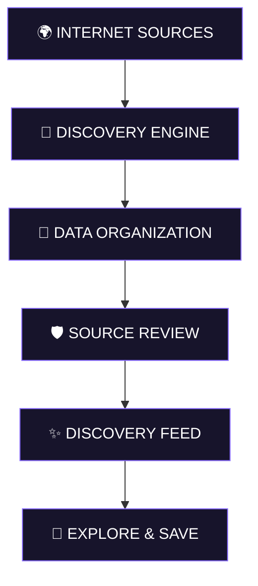

<div align="center">

<svg width="100%" viewBox="0 0 1200 430" xmlns="http://www.w3.org/2000/svg">
<defs>
<linearGradient id="bg" x2="1" y2="1"><stop stop-color="#080914"/><stop offset="1" stop-color="#24134d"/></linearGradient>
<linearGradient id="neon"><stop stop-color="#9B75FF"/><stop offset="1" stop-color="#35D9FF"/></linearGradient>
<radialGradient id="orb"><stop stop-color="#936BFF" stop-opacity=".7"/><stop offset="1" stop-color="#372078" stop-opacity="0"/></radialGradient>
</defs>
<rect width="1200" height="430" rx="24" fill="url(#bg)"/>
<circle cx="950" cy="210" r="190" fill="url(#orb)"/>
<g transform="translate(950 210)" fill="none" stroke="url(#neon)">
<circle r="135" stroke-opacity=".5"/>
<ellipse rx="180" ry="65" transform="rotate(-35)" stroke-opacity=".8"/>
<ellipse rx="180" ry="65" transform="rotate(35)" stroke-opacity=".7"/>
<circle r="75" stroke-opacity=".6"/>
<circle r="30" fill="#8F6BFF" fill-opacity=".35" stroke-width="2"/>
<circle r="10" fill="#FFFFFF"/>
</g>
<g fill="#9D8AFF">
<circle cx="790" cy="90" r="5"/><circle cx="1110" cy="100" r="4"/>
<circle cx="1120" cy="320" r="6"/><circle cx="810" cy="330" r="4"/>
</g>
<g fill="#FFFFFF" font-family="Arial,sans-serif">
<text x="75" y="90" font-size="23" letter-spacing="5" fill="#A78BFA">◈ OPEN DISCOVERY NETWORK</text>
<text x="75" y="175" font-size="68" font-weight="bold">OPENINFO</text>
<text x="78" y="226" font-size="30" fill="#BBA6FF">Discover Beyond the Obvious.</text>
<text x="80" y="280" font-size="17" fill="#C2C2D6">AI · Open Source · Hidden Tools · Research</text>
<text x="80" y="310" font-size="17" fill="#C2C2D6">Emerging Technology · Digital Discoveries</text>
<rect x="78" y="345" width="220" height="44" rx="10" fill="url(#neon)"/>
<text x="188" y="373" font-size="14" font-weight="bold" text-anchor="middle">EXPLORE THE UNKNOWN</text>
</g>
</svg>

# OPENINFO
### THE OPEN DISCOVERY INTELLIGENCE PLATFORM

**Find what others haven't discovered yet.**


[EXPLORE REPOSITORY](https://github.com/shivankd814-debug/OPENINFO) · [ISSUES](https://github.com/shivankd814-debug/OPENINFO/issues)

</div>

---

<div align="center">

## ◈ A UNIVERSE OF DISCOVERIES

*The internet is bigger than the search results you usually see.*

</div>

<table>
<tr>
<td align="center" width="33%">
<h2>✳</h2>
<b>AI INTELLIGENCE</b>
<br/><sub>Models · Agents · Tools · Releases</sub>
</td>
<td align="center" width="33%">
<h2>⌘</h2>
<b>OPEN SOURCE</b>
<br/><sub>GitHub · Libraries · Frameworks</sub>
</td>
<td align="center" width="33%">
<h2>✧</h2>
<b>HIDDEN GEMS</b>
<br/><sub>Websites · Utilities · Digital tools</sub>
</td>
</tr>
<tr>
<td align="center">
<h2>◇</h2>
<b>FREE RESOURCES</b>
<br/><sub>Software · Courses · Alternatives</sub>
</td>
<td align="center">
<h2>⌬</h2>
<b>RESEARCH LAB</b>
<br/><sub>Science · Papers · Innovation</sub>
</td>
<td align="center">
<h2>◷</h2>
<b>FUTURE RADAR</b>
<br/><sub>Announcements · Upcoming launches</sub>
</td>
</tr>
</table>

---

## ◉ THE DISCOVERY EXPERIENCE

<div align="center">



</div>

## 🧬 AGENT INTELLIGENCE

**A specialist-agent architecture for organized discovery.**

| Agent | Mission |
|---|---|
| 🎯 Master Coordinator | Workflow coordination |
| 🤖 AI Scout | AI tools and models |
| ⌘ GitHub Scout | Open-source projects |
| 🔬 Research Scout | Research and papers |
| ⚡ Trend Analyst | Emerging technology |
| 💎 Free Tools Scout | Free digital resources |
| 🚀 Launch Tracker | Upcoming launches |
| 🛡️ Security Reviewer | Security review signals |
| 🔍 Source Verifier | Source credibility |
| 💰 Pricing Analyst | Pricing information |
| 🎓 Student Scout | Student resources |
| 🌐 Web Scout | Website discoveries |

<sub>These describe architecture roles; only implemented and connected workflows are operational.</sub>

---

## 📡 DISCOVERY SOURCE NETWORK

<div align="center">


</div>

Current foundation includes selected collectors for GitHub, Hugging Face, Hacker News, OpenAlex and public RSS feeds from freeCodeCamp News and Hugging Face Blog.

---

## ⚙️ TECHNOLOGY CORE

<div align="center">


</div>

| Layer | Technology |
|---|---|
| Frontend | HTML · CSS · JavaScript |
| Backend | Node.js |
| API | REST |
| Storage | JSON prototype |
| Browser Extension | Chrome Manifest V3 |
| Data Sources | Public APIs · RSS |

---

## 🏗️ PROJECT ARCHITECTURE

```text
OPENINFO/
│
├── public/
│   ├── index.html
│   ├── styles.css
│   └── app.js
│
├── server/
│   ├── index.js
│   ├── agents/
│   └── collectors/
│
├── data/
│   └── categories.json
│
├── extension/
├── docs/
├── scripts/
│
├── ARCHITECTURE.md
├── ROADMAP.md
├── SECURITY.md
├── SOURCE_POLICY.md
└── README.md
```

---

## 🚀 GET STARTED

**Requirements:** Node.js 20+ and Git.

```bash
git clone https://github.com/shivankd814-debug/OPENINFO.git
cd OPENINFO
node server/index.js
```

Open the website at the address configured by your server.

---

## 🔌 API CONTROL CENTER

| Method | Endpoint | Purpose |
|---|---|---|
| GET | `/api/health` | Backend health |
| GET | `/api/categories` | Categories |
| GET | `/api/discoveries` | Discovery feed |
| GET | `/api/status` | System status |
| POST | `/api/scan` | Trigger scan |
| POST | `/api/report` | Submit report |
| POST | `/api/extension/save` | Save discovery |
| GET | `/api/extension/saved` | Saved discoveries |

---

## 🌌 ROADMAP

| Feature | Status |
|---|---|
| Node.js backend foundation | Implemented foundation |
| Discovery categories | Initial implementation |
| Public-source collectors | Initial implementation |
| Chrome extension | Initial implementation |
| Advanced agent automation | Planned |
| Multilingual interface | Planned |
| Advanced verification | Planned |
| Discovery notifications | Planned |
| Personalized dashboard | Planned |
| More source integrations | Planned |

---

## 🔐 OUR PRINCIPLES

- Free-first discovery.
- Original source links.
- Transparent pricing information.
- Respect public API limits.
- Respect website terms and privacy.
- No unauthorized private-data collection.
- No false claims about unimplemented features.

**Useful discoveries should be accessible to everyone.**

---

## 🤝 CONTRIBUTE TO OPENINFO

Have an idea? Found something interesting? Want to improve the platform?

- [Report a bug](https://github.com/shivankd814-debug/OPENINFO/issues)
- [Suggest a feature](https://github.com/shivankd814-debug/OPENINFO/issues)
- [Contribute code](https://github.com/shivankd814-debug/OPENINFO/pulls)

---

<div align="center">

<svg width="100%" viewBox="0 0 900 150" xmlns="http://www.w3.org/2000/svg">
<defs><linearGradient id="foot"><stop stop-color="#11102B"/><stop offset="1" stop-color="#5331A5"/></linearGradient></defs>
<rect width="900" height="150" rx="20" fill="url(#foot)"/>
<text x="450" y="67" text-anchor="middle" font-size="36" font-family="Arial" font-weight="bold" fill="white">OPENINFO</text>
<text x="450" y="103" text-anchor="middle" font-size="15" font-family="Arial" fill="#C5B6FF">DISCOVER BEYOND THE OBVIOUS.</text>
</svg>

**Created by Shivank Dwivedi**

[REPOSITORY](https://github.com/shivankd814-debug/OPENINFO)

<sub>Built for the curious. Designed for discovery.</sub>

</div>
